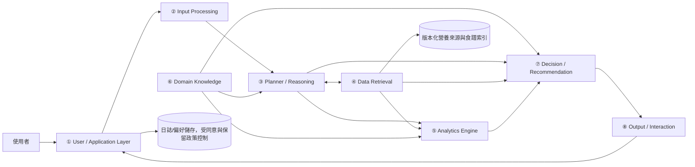
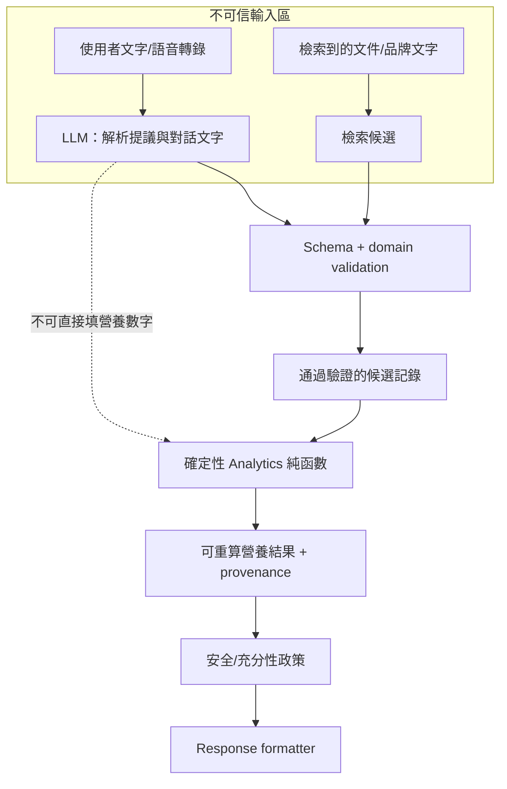
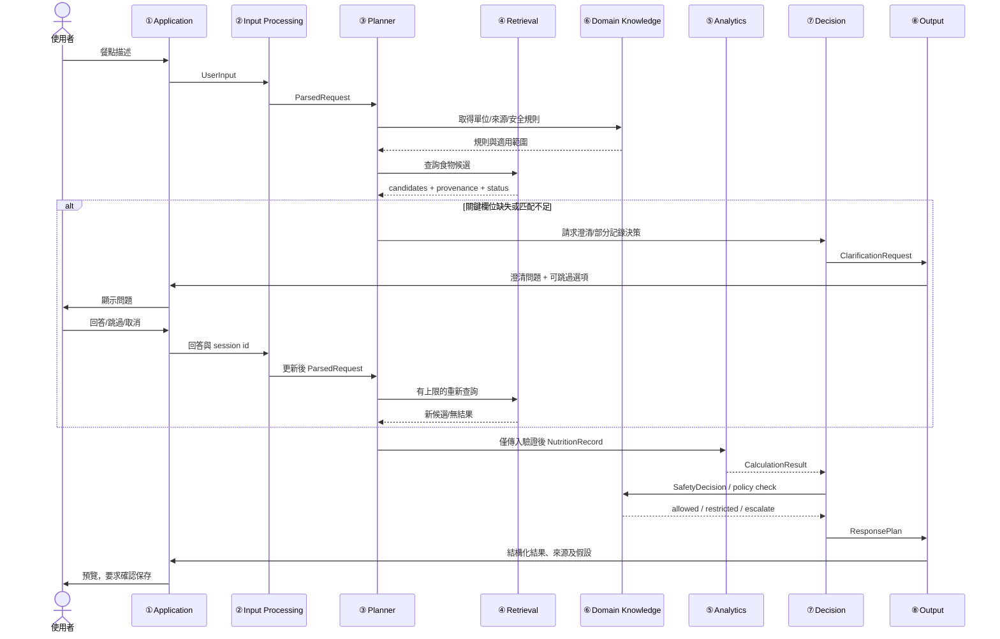
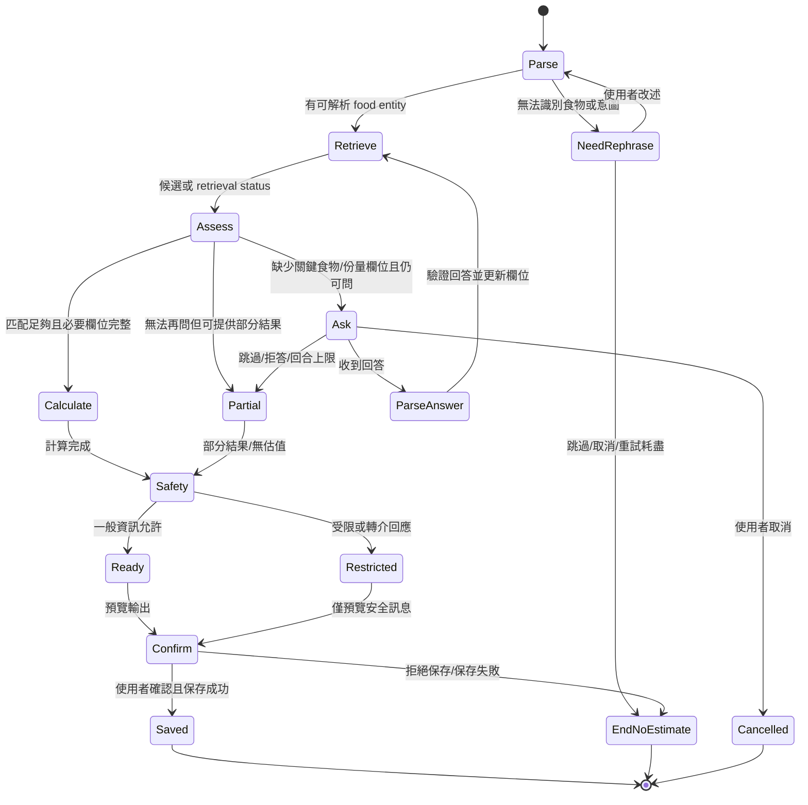
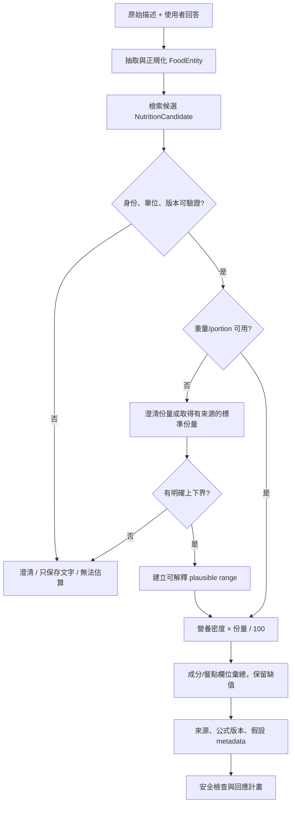
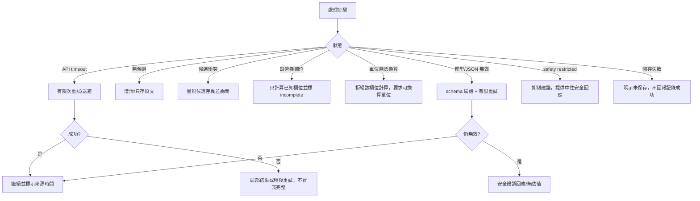

# DietSense 架構、資料流與資料合約

本文件細化 [DESIGN.md](../../DESIGN.md) 的八模組架構。模組是邏輯邊界，不要求未來程式必須部署成八個服務。所有介面和合約均為提案規格，尚未實作。

## 1. 高階架構圖

### 信任區域

LLM 只提出意圖、實體/欄位解析及澄清文案。通過 schema 驗證的營養欄位由資料來源 adapter 提供，Analytics Engine 只接受結構化值。LLM 產生的數字不得成為 NutritionRecord、CalculationResult 或每日總計的輸入。

## 2. 模組規格與介面

| 模組 | 責任 | 輸入 → 輸出 | 依賴 | 錯誤/復原 | 驗收條件 | 需求 |
|---|---|---|---|---|---|---|
| ① User / Application Layer | 收取使用者訊息、呈現結果、接受確認/修改/跳過/刪除 | `UserInput`、使用者動作 → `ResponseEnvelope`、已確認動作 | ②、⑧、同意控制儲存層 | 輸入超限或身份/儲存不可用時告知失敗，不假裝成功；可重試或只顯示未保存草稿 | 使用者可確認保存前預覽記錄；保存失敗不回報已記錄 | FR-001, 007, 010, 012; NFR-004, 010 |
| ② Input Processing | 正規化文字；保留原文；解析意圖/食物/份量/餐別/烹調詞，轉成 schema | `UserInput` → `ParsedRequest`/validation issues | LLM parser（可替換）、語言正規化器、schema | LLM timeout/JSON 無效時有限重試；仍失敗則提供文字記錄或請使用者改述 | unknown 欄位不補默認值；原始字詞可回溯 | FR-001–003, 008; NFR-001, 008 |
| ③ Planner / Reasoning | 將意圖映射至有限狀態工作流程；決定工具次序、澄清與終止 | `ParsedRequest` + `SessionState` → `PlanStep` / `ClarificationRequest` / 終態 | ②、④–⑦、狀態機 | 未知意圖、安全拒絕、步數上限及工具錯誤均有終態；不得讓模型自由決定工具權限 | 每個意圖恰進入受控分支；澄清回合達上限可退出 | FR-005, 008, 009, 011; NFR-001, 009 |
| ④ Data Retrieval | 查詢有許可且版本化的食品/營養/配方資料；排名候選，不自行生成值 | `FoodEntity` + source filters → `NutritionCandidate[]` + retrieval status | USDA FDC adapter、待確認的台灣來源、地方食譜索引 | timeout/無結果/衝突時回傳狀態和部分候選；不將舊快取冒充最新值 | 每個候選含 source ID、版本、匹配依據、欄位來源及單位 | FR-003, 004, 008; NFR-002, 003, 007, 009 |
| ⑤ Analytics Engine | 單位檢查、營養密度縮放、成分彙總、每日加總、可選 REE/TDEE 函數 | `NutritionRecord[]`/`DailyLog` → `CalculationResult`/`DailySummary` | ④ 結果、⑥ 定義與公式版本 | 欄位缺失/單位不符/輸入非有限數值時拒算該欄位並列問題 | 固定輸入快照可重算相同結果；每項輸出有公式版本和來源 | FR-006, 007, 010; NFR-002, 008 |
| ⑥ Domain Knowledge | 管理食品狀態/單位、來源優先序、一般指南適用範圍、安全政策版本 | `KnowledgeQuery`/使用者情境 → `KnowledgeResult`/`PolicyDecision` | 官方資料/指南、專業審查紀錄 | 規則過期或無法判定時採保守通用回答/不提供建議 | 每條建議規則記來源、版本、審查者/審查狀態、適用範圍 | FR-003, 006, 009, 011; NFR-003, 005 |
| ⑦ Decision / Recommendation | 合併意圖、營養結果、資料完整性和安全決策；決定可回答範圍 | `ParsedRequest` + candidates/results + `SafetyDecision` → `ResponsePlan` | ③–⑥ | 安全拒答優先於建議；不足資料則 ask/partial/no estimate；不得由模型跳過 gate | 每條分支記錄決策原因及依據；無可信營養結果時無數值建議 | FR-007–011; NFR-001, 007, 009 |
| ⑧ Output / Interaction | 格式化自然語言和結構化資料，呈現來源、假設、缺值、單位及後續選項 | `ResponsePlan` → `ResponseEnvelope` | ①、⑦ | 格式器/圖表失敗不影響文字結果；缺來源欄位則隱藏數值而顯示無法確認 | 回答不得讓估算看似實測；可見來源/範圍/限制，且純文字足以理解 | FR-010, 011; NFR-003, 006, 010 |

## 3. 食物記錄序列

若缺關鍵值，澄清後至多重新查詢設定的回合上限（預設設計上限為 2 次，待可用性測試調整）；回合用盡後可採明示假設範圍或只存原文。保存需使用者確認；不同產品隱私政策下可另行評估明確同意的快速記錄模式。

## 4. 澄清狀態流程

## 5. 營養計算流程

## 6. 錯誤與 fallback 流程

所有重試須有次數、timeout 和冪等策略；任何 fallback 均不得把缺失資料轉成 0、把 candidate score 轉成校準信心或未保存內容標記為日誌。

## 7. 資料合約

JSON-like 欄位型別表示概念型別；實作前仍需選擇具版本控制的 schema。所有 object 均應另帶 `schema_version`。必填欄位缺漏即 validation error，除非明確標為 optional。缺未知值用 null 並帶 `unknown_reason`；不能用數字 0 表示未知。

### 7.1 `UserInput`

| 欄位 | 必要性 / 型別 | 單位/限制 | provenance / 缺值處理 |
|---|---|---|---|
| `schema_version` | 必填 `string` | Schema 版本 | 系統 |
| `request_id` | 必填 `string` | 唯一請求 ID | 系統產生 |
| `session_id` | 必填 `string` | pseudonymous session key | 不放姓名/電話等直接識別資料 |
| `text_original` | 必填 `string` | 非空；限制最大長度由 API 定義 | 使用者原文；只按同意政策留存 |
| `locale` | 必填 `string` | BCP-47，例如 `zh-TW` | 系統偵測、可由使用者改正 |
| `occurred_at` | 選填 `datetime|null` | ISO 8601 + timezone | 使用者輸入或接收時間；未知不推定 meal time |
| `consent_scope` | 必填 enum | `session_only / save_log / research_opt_in` 等經審查選項 | 明確同意事件，不從使用行為推定 |
| `attachments` | 選填 `AttachmentRef[]` | 只允許政策核准 MIME/大小 | 預設不要求照片；保留最小元資料 |

### 7.2 `FoodEntity`

| 欄位 | 必要性 / 型別 | 單位/限制 | provenance / 缺值處理 |
|---|---|---|---|
| `entity_id` | 必填 `string` | 請求內唯一 | 系統 |
| `name_original` | 必填 `string` | 原始片段 | 來源 `user_text` + span |
| `name_normalized` | 選填 `string|null` | 受控正規化名稱 | parser/version；不確定可為 null |
| `food_type` | 選填 enum | `single_food / mixed_dish / packaged / unknown` | parser 提議，需驗證 |
| `ingredients` | 選填 `IngredientMention[]` | 每項保留名稱和明示份量 | 使用者明述或已審核 recipe；不可從菜名臆測 |
| `preparation` | 選填 `string|null` | 油炸/煮/生等 | 原文 span；未知為 null |
| `portion` | 選填 `PortionEstimate|null` | 量綱需明確 | 原文或使用者澄清；不得默認一碗克數 |
| `meal_type` | 選填 enum/null | breakfast/lunch/dinner/snack/unknown | 原文或使用者選擇 |
| `extraction_status` | 必填 enum | `parsed / partial / failed` | 由 parser 驗證結果 |

### 7.3 `PortionEstimate`

| 欄位 | 必要性 / 型別 | 單位/限制 | provenance / 缺值處理 |
|---|---|---|---|
| `quantity` | 選填 `decimal|null` | > 0；不可 NaN/Infinity | 使用者/來源 |
| `unit` | 選填 enum/string/null | `g, kg, ml, piece, bowl, cup, serving` 等 | 原始單位另保存；體積不可未經密度換算成質量 |
| `mass_g` | 選填 `decimal|null` | 正值 g；測量/標準換算須記錄 | 明示克數或可追溯轉換；未知 null |
| `mass_low_g`, `mass_high_g` | 選填 `decimal|null` | 若皆有值須 `0 < low <= high` | 來自來源界限或確認範圍；不得靠置信分數虛構 |
| `leftover_fraction` | 選填 `decimal|null` | 0–1，僅表示剩食比例且定義清楚 | 使用者報告/秤重；未知 null |
| `method` | 必填 enum | `user_weight / label_serving / household_unit / recipe_derived / image_estimate / unknown` | 方法記錄 |
| `assumptions` | 必填 `string[]` | 可空陣列 | 不可隱藏份量推定 |
| `uncertainty_status` | 必填 enum | `bounded / point_only / unknown` | range 只能依明示上下界 |

### 7.4 `NutritionCandidate`

| 欄位 | 必要性 / 型別 | 單位/限制 | provenance / 缺值處理 |
|---|---|---|---|
| `candidate_id` | 必填 `string` | 本次候選唯一 | retrieval |
| `source_id`, `source_version` | 必填 `string` | source registry ID + snapshot/version/date | 可查來源註冊表 |
| `food_id` | 必填 `string` | 外部/內部來源項目 ID | 不可只靠文字描述 |
| `display_name` | 必填 `string` | 來源原名 | 來源直接返回 |
| `food_state` | 選填 enum/null | raw/cooked/prepared 等 | 原始來源欄位；未知 null |
| `nutrients_per_100g` | 必填 `map<string, decimal|null>` | 能量 kcal/100g；宏量營養 g/100g | 逐欄 source field ID；null 代表未提供 |
| `value_basis` | 必填 enum | `measured / calculated / label / unknown` | 來源方法 |
| `rank_score` | 選填 `decimal|null` | 只代表排序分數，不得稱機率 | 檢索模型版本及特徵 |
| `match_reasons` | 必填 `string[]` | 可為空 | 可讀的匹配特徵 |
| `retrieved_at` | 必填 `datetime` | ISO 8601 | 系統時間 |
| `source_caveats` | 必填 `string[]` | 可空陣列 | 收錄、食譜或營養欄位限制 |

### 7.5 `NutritionRecord`

| 欄位 | 必要性 / 型別 | 單位/限制 | provenance / 缺值處理 |
|---|---|---|---|
| `record_id` | 必填 `string` | 日誌項唯一 | 系統 |
| `food_entity_id` | 必填 `string` | 連結解析輸入 | UserInput |
| `selected_candidate_id` | 必填 `string` | 已由使用者或規則確認的 candidate | 不確定時不建立營養記錄 |
| `portion` | 必填 `PortionEstimate` | 可為 unknown 狀態但不能缺物件 | 說明無法計算原因 |
| `computed_nutrients` | 必填 map | kcal / g，未知為 null | CalculationResult + formula version |
| `source_lineage` | 必填 `SourceRef[]` | 至少一個 source for numeric nutrient | source ID/version/field ID |
| `created_at`, `food_time` | 必填/選填 datetime | ISO 8601 TZ | 系統/使用者；未知 food time 為 null |
| `status` | 必填 enum | `confirmed / draft / text_only / incomplete` | 保存前須有使用者確認或有效同意模式 |

### 7.6 `CalculationResult`

| 欄位 | 必要性 / 型別 | 單位/限制 | provenance / 缺值處理 |
|---|---|---|---|
| `calculation_id` | 必填 `string` | 唯一 | 系統 |
| `formula_version` | 必填 `string` | 固定計算版本 | 算法登錄 |
| `inputs_hash` | 必填 `string` | 版本化輸入快照雜湊 | 不得以 hash 替代合法刪除 |
| `nutrients` | 必填 map | kcal 或 g | 每欄 nullable；缺任何成分時 `completeness=partial` |
| `range` | 選填 object/null | `low <= point <= high`，單位明確 | 上下界輸入、採用方法及 assumptions 必須列明 |
| `completeness` | 必填 enum | `complete / partial / not_calculable` | 缺值規則 |
| `warnings` | 必填 `string[]` | 可空 | 如 raw/cooked mismatch、未知油量 |
| `computed_at` | 必填 datetime | ISO 8601 | 系統 |

### 7.7 `ClarificationRequest`

| 欄位 | 必要性 / 型別 | 限制 | provenance / 缺值處理 |
|---|---|---|---|
| `clarification_id` | 必填 `string` | 唯一 | 系統 |
| `entity_id` | 必填 `string` | 指向待解決 entity | 來源解析 |
| `target_field` | 必填 enum/string | `identity / portion / preparation / leftover / other` | 需是本次輸出的關鍵欄位 |
| `question_text` | 必填 `string` | 單一、可回答、中性 | 由模板或受限生成；不可暗示答案 |
| `answer_options` | 選填 `string[]` | 需包含「不知道/略過」路徑 | 候選只能源於證據/使用者選擇 |
| `turn_index`, `max_turns` | 必填 int | 0 <= index <= max | 防止無限澄清 |
| `on_skip` | 必填 enum | `partial / text_only / cancel` | 明確終態 |
| `expires_at` | 選填 datetime/null | session policy | 過期後不再使用回答狀態 |

### 7.8 `DailySummary`

| 欄位 | 必要性 / 型別 | 限制 | provenance / 缺值處理 |
|---|---|---|---|
| `date` | 必填 date | 使用者時區日曆日 | Profile 設定；未知則詢問或使用當地預設並註明 |
| `record_ids` | 必填 `string[]` | 僅納入已確認/指定狀態記錄 | 日誌來源 |
| `totals` | 必填 map | kcal / g；有未知項則 null 或明示 partial | 聚合公式版本與各 record ID |
| `coverage` | 必填 map | `included / incomplete / excluded` 數量 | 不能默默略過文字-only 記錄 |
| `tdee_estimate` | 選填 object/null | kcal/day + formula/inputs/eligibility | 不具資格或輸入不足為 null |
| `intake_minus_tdee` | 選填 decimal/null | kcal/day，只在雙方有效可計時存在 | 非體重預測；結果不得作處方 |
| `warnings` | 必填 `string[]` | 可空 | 含估算、缺漏和日期界限 |

### 7.9 `SafetyDecision`

| 欄位 | 必要性 / 型別 | 限制 | provenance / 缺值處理 |
|---|---|---|---|
| `decision_id` | 必填 `string` | 唯一 | 系統 |
| `status` | 必填 enum | `allow_general / restrict / refuse / refer` | 由版本化規則輸出 |
| `trigger_codes` | 必填 `string[]` | 可空 | 不記錄不必要的敏感自由文字副本 |
| `policy_version` | 必填 `string` | 可追溯版本 | Domain Knowledge registry |
| `allowed_content` | 必填 `string[]` | 白名單型輸出類別 | 不由 LLM 自行擴權 |
| `blocked_content` | 必填 `string[]` | 例如診斷、治療或極端限制方案 | 規則庫 |
| `review_status` | 必填 enum | `pending_professional_review / approved` | 目前所有政策標示 pending，正式使用前需審核 |
| `user_message` | 必填 `string` | 中性、非診斷 | 模板版本；不含判定病症 |

## 8. 回應封套建議

所有回答由結構化 `ResponseEnvelope` 渲染：`request_id`、`intent`、`status`、`answer_text`、`nutrition_records[]`、`calculation_results[]`、`sources[]`、`assumptions[]`、`unknown_fields[]`、`clarification_request|null`、`safety_decision`。格式層不得再計算營養值；若圖表生成失敗，保留表格/文字摘要。
