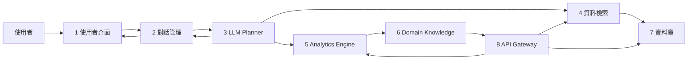
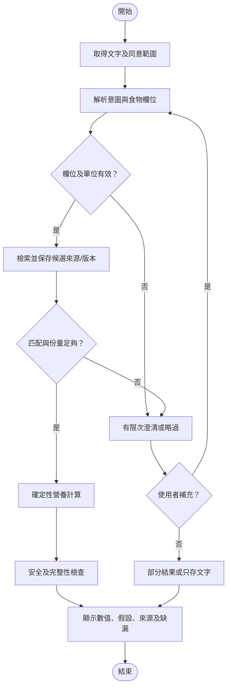

# DietSense：台灣日常飲食熱量分析之對話式領域 AI Agent

## 1. 專題概述

**研究狀態：** 本文件為研究計畫書。DietSense 尚未實作；資料集、招募、實驗及使用者研究均屬規劃，本文沒有實測結果。

DietSense 擬研究一個繁體中文對話式飲食記錄流程，聚焦台灣餐點描述中的食物對應、份量不確定性、營養資料來源與可重現計算。系統構想沿用原提案八個概念模組：①使用者介面、②對話管理、③LLM Planner、④資料檢索、⑤Analytics Engine、⑥Domain Knowledge、⑦資料庫、⑧API Gateway。LLM 負責理解文字與協調工具；來源選擇、數值換算和安全限制由可檢查的資料、公式及規則承擔。

本研究問題為：對於繁體中文台灣混合料理描述，結合結構化營養資料檢索、有限次澄清、確定性計算及逐筆來源追溯的對話流程，能否產生可檢視的估算？與固定版本的人工搜尋輸入流程相比，其估算誤差、任務時間、完成率及澄清負擔如何？研究不預設對話流程優越，也不以一般性「首創」主張定位。

## 2. 摘要

世界衛生組織估計，2024 年全球約有 26 億名成人過重，其中 9.4 億人有肥胖；台灣國民健康署報告，2020–2024 年國民營養健康調查中，18 歲以上成人過重與肥胖合計為 51.3% [1], [2]。這些數據提供公共衛生背景，並不證明飲食記錄工具具有預防或治療效果。飲食自我監測已用於行為性體重管理介入；一項涵蓋 59 項研究的系統性回顧指出，介入形式及依從性衡量不一，使用量和結果的關係仍未充分釐清 [3]。

本計畫聚焦繁體中文台灣餐點描述中的食物匹配、份量與配方資訊不完整問題。既有研究已探討影像式營養估算、飲食自由文字映射、領域營養模型及台灣影像飲食評估；因此，本研究將缺口限定為尚待驗證的工作流程：把多輪澄清、適用營養來源、確定性計算及來源追溯整合於台灣混合料理文字記錄，並與明確基線比較。

擬議 DietSense 以大型語言模型解析意圖及餐點欄位，透過檢索層查詢 USDA FoodData Central [4] 與待完成版本、授權及欄位查核的台灣食品成分及在地食譜資料；Analytics Engine 依已確認份量與來源營養密度計算熱量及巨量營養素。資訊不足時，系統有限次追問或以文字記錄/部分估算降級；只有可說明假設時才呈現合理估算範圍，不稱為統計信賴區間。系統定位為一般記錄資訊，不診斷或治療疾病。

研究規劃建立 500 筆繁體中文台灣餐點描述及參照標籤，與預先指定的人工搜尋輸入流程比較，評估食物識別、熱量與巨量營養素誤差、來源追溯、完成率、記錄時間及澄清負擔；另規劃 20 名成人、七日的可行性研究。招募前仍須完成倫理審查、同意、隱私程序及 protocol。預期成果是可檢驗的資料標註與評估流程、具來源追溯的對話式系統設計，以及對估算與使用性限制的實證描述；預期門檻不是已達成結果。

**索引詞：** 對話式 AI Agent、飲食自我監測、營養資料檢索、台灣料理、份量估算、不確定性溝通。

## 3. 緒論

### 3.1 背景與動機（A2Z G）

全球及台灣成人過重/肥胖統計說明飲食與健康是重要公共議題 [1], [2]，但不能由盛行率推論任何單一記錄工具的成效。飲食自我監測是部分行為性體重管理介入的組成；回顧研究顯示介入強度與記錄方式差異大，依從性指標不一致 [3]。本計畫因此研究更易檢視的記錄流程，而不承諾健康改善。

### 3.2 技術與領域背景（A2Z H）

資料庫式記錄需要辨識食物候選、份量及食物狀態。份量估算工具的驗證方法與品質不一 [5]；影像估算研究的整體能量結果有研究間異質性，不能套用成任何單一系統的固定誤差 [6]。USDA FoodData Central 提供可查詢資料與 API [4]，台灣食藥署維護台灣地區食品營養成分資料庫 [7]；資料庫存在不代表每一店家配方或複合菜餚都能精確匹配。

LLM 可協助自然語言解析，RAG 可把外部檢索納入生成流程 [8]；兩者本身不保證營養正確。故本研究採用「語言模型理解、結構化資料檢索、規則驗證、確定性計算」分工。個人化營養研究須按族群和任務解讀；特定餐後血糖預測研究不能直接支持一般熱量處方 [9]，DIETFITS 試驗也未發現其所測基因型或基線胰島素分泌可預測低脂與低碳飲食的 12 個月減重差異 [10]。

### 3.3 問題陳述與限制（A2Z I–J）

「一碗加蛋牛肉麵，湯喝一半」仍缺少碗量、麵量、肉量、配方與湯汁攝取量等欄位。若候選資料僅名稱相似，直接報單一精確值會掩蓋匹配及份量假設。此處是可操作的資料/互動問題，不是「台灣資料庫沒有這些食物」的既定事實；各品項覆蓋須以查庫與抽樣驗證。

本計畫不假設既有系統普遍失效。既有工作已涉及飲食自由文字映射、NutriRAG、FoodyLLM、LLM 文字營養估值、FoodMapper、DietAI24 及台灣影像評估。可檢驗的範圍是：在繁體中文台灣混合料理任務中，多輪澄清、資料來源與版本記錄、單位檢查、確定性計算及人工搜尋基線比較，對誤差與記錄負擔的表現如何。

### 3.4 研究目標、創新定位與貢獻（A2Z K–L）

本計畫目標為：(1) 建立有參照標籤及來源紀錄的 500 筆餐點描述資料集；(2) 定義繁體中文餐點抽取、候選檢索、澄清、計算及降級流程；(3) 量測識別、數值誤差、來源追溯與互動負擔；(4) 進行小規模可行性使用評估。預期貢獻在於把上述流程置於同一可比較的台灣飲食記錄研究設計中，而非宣稱首創 LLM、RAG 或營養資料庫整合。

## 4. 相關研究

### 4.1 AI 技術與食品語言理解

食品 NER、食品 ontology 與實體連結研究顯示，名稱抽取、概念對應與份量估計是不同任務 [11]–[14]。RAG 和 ReAct 提供檢索/工具協作的一般方法 [8], [15]，不是營養準確性的證據。Nutrition5k 支持影像營養估算研究，但其美國餐點資料不能代替台灣代表性資料 [16]。DietAI24 已結合多模態 LLM、RAG 與 FNDDS；其影像任務與資料源不同於本研究的台灣文字多輪記錄 [17]。

FoodMapper 比較自由文字映射方法；NutriRAG 評估飲食日誌文字分類；FoodyLLM 探索食品營養領域模型；Lawabni 等人和 Cao 等人研究 LLM 食品營養估值 [18]–[22]。這些成果已排除「自由文字映射或中文食品 LLM 尚未被研究」的寬泛缺口。不同研究使用的國家、來源、測試資料、任務及指標不同，不能直接推論本提案任務的效果。台灣 Diabot-GPT-4o 以影像和秤重紀錄研究飲食估算，是重要在地先例，但不等同於文字對話系統 [23]。

### 4.2 營養領域知識與參照方法

份量估算工具驗證品質與適用情境各異 [5]；影像飲食評估統合結果亦有異質性 [6]。FoodData Central 與台灣食藥署資料庫可作檢索來源 [4], [7]，需保留來源、版本、食物狀態及每 100 g 數值基準。能量換算依來源欄位及其定義；通用 Atwater 因子不應在無標記下取代來源能量值 [24]。

Mifflin–St Jeor 是 REE 預測公式，不是代謝測量 [25]；National Academies 的能量 DRI 方程是群體參照工具 [26]。台灣一般營養參照應以研究啟動時核實的衛福部最新版官方指引為準 [27]。飲食自我監測、飲食品質、能量平衡及體重變化是相關但不同概念；超加工飲食住院交叉試驗和 DIETFITS 等研究需依其族群、期間與設計解讀 [10], [28]。系統不以 REE/TDEE 估計生成個人處方。

### 4.3 Article Summary Table（A2Z M）

| ID / 文獻 | 研究焦點與資料 | 可支持的結論 | 主要限制及本研究用途 |
|---|---|---|---|
| RW01 Lewis et al. [8] | RAG；知識密集型 NLP | 檢索可與生成結合 | 非營養驗證；支援架構背景 |
| RW02 Yao et al. [15] | ReAct；推理與工具互動 | 可研究工具協作模式 | 非飲食效能證據 |
| RW03 Popovski et al. [11] | FoodBase 食譜食品實體語料 | 食品實體需專門標註 | 食譜語料不代表繁中日誌 |
| RW04 Stojanov et al. [12] | FoodNER 模型與食品類別 | 食品 NER 可獨立評估 | 不能推論營養估值正確 |
| RW05 Ogrinc et al. [14] | ChatGPT 食品 NER/NEL | LLM 可作抽取基線 | 語料與任務有限，需本地測試 |
| RW06 Feher et al. [13] | 食品實體連結方法 | 字串/模型連結需知識庫 | 映射不等於份量估計 |
| RW07 Thames et al. [16] | Nutrition5k，約 5,000 餐點 | 視覺營養估算研究資料 | 美國來源，非台灣代表樣本 |
| RW08 Yan et al. DietAI24 [17] | MLLM+RAG+FNDDS 影像分析 | 已有相近 AI/檢索整合 | 影像、美國資料及任務不同 |
| RW09 Ho et al. [6] | 影像飲食估算系統回顧/統合 | 整體估算有異質性 | 不可當成單系統固定誤差 |
| RW10 Amoutzopoulos et al. [5] | 份量工具系統回顧 | 工具需按情境驗證 | 驗證品質和工具差異大 |
| RW11 Mifflin et al. [25] | 健康成人 REE 方程 | 提供群體預測公式 | 非個人代謝測量或處方 |
| RW13 Raber et al. [3] | 59 項自我監測介入研究 | 監測可作介入組件研究 | 依從性及使用量關係不一致 |
| RW14 Hall et al. [28] | 超加工飲食住院交叉試驗 | 特定條件下比較飲食攝取 | 樣本/期間有限，非 DietSense 證據 |
| RW15 Gardner et al. [10] | DIETFITS，609 成人 | 測試飲食型態及交互作用 | 結果限試驗族群、介入與期間 |
| RW16 Lemay et al. FoodMapper [18] | ASA24/FooDB、NHANES/DFG2 映射 | 混合檢索可測食品映射 | 該資料與任務不代表台灣料理 |
| RW17 Zhou et al. NutriRAG [19] | 飲食日誌 RAG 分類 | 自由文字分類已有直接研究 | 特定資料/參與者及分類任務 |
| RW18 Gjorgjevikj et al. FoodyLLM [20] | 食品營養領域模型 | 領域對齊模型是既有方向 | benchmark 不等於互動日誌效能 |
| RW19 Lawabni et al. [21] | 194 美國常見食品，LLM/NCC | 估值誤差因營養素而異 | 美國食品及特定資料庫 |
| RW20 Cao et al. [22] | 中國食物成分表、LLM 比較 | 能量/巨量營養素可個別評估 | 不等於台灣混合料理對話 |
| RW21 Chen et al. Diabot-GPT-4o [23] | 57 位年輕成人、714 張影像、秤重 | 台灣有 AI 飲食影像先例 | 影像研究，非文字多輪互動 |

### 4.4 研究缺口與綜合分析（A2Z N–O）

本次搜尋是範圍性查核，並非系統性回顧；資料庫介面、語言及發表時間存在限制 [29]。因此，研究缺口採待測問題而非不存在性主張：在台灣混合料理自由文字記錄中，結構化來源、有限次澄清、數值可重算與逐項追溯能否同時維持可接受誤差與任務負擔。以下 SWOT 總結研究定位。

| 面向 | 現有研究優勢 | 現有研究限制 | DietSense 對應 | 待驗證證據 |
|---|---|---|---|---|
| 食品語言 | 有 NER/NEL、日誌映射方法 | 語言與食品知識庫不同 | 繁體中文抽取及候選映射 | 分類/映射測試集 |
| 營養估算 | 有影像及 LLM 估值工作 | 混合料理、份量與來源差異 | 檢索後確定性計算 | 參照營養值與誤差 |
| 互動流程 | Agent/工具協作可提供方法背景 | 對話成本與澄清效果未知 | 有界追問、可跳過、fallback | 時間、完成率、澄清負擔 |
| 在地化 | 台灣已有資料庫及影像先例 | 不代表每道菜/店家已覆蓋 | 來源版本與配方治理 | 查庫覆蓋及追溯率 |
| 安全/證據 | 有營養與臨床指引 | 小型試驗不能證明臨床效益 | 一般記錄、非診斷、轉介邊界 | 專業審查及安全案例測試 |

## 5. Deep Research

以下五個核心思維、三項爭議及十個深度問題皆是設計推理與待驗證假設，不是已取得的系統結果。相關證據與限制另見 [five-core-mindsets.md](../research/five-core-mindsets.md)、[three-professional-controversies.md](../research/three-professional-controversies.md)、[ten-deep-questions.md](../research/ten-deep-questions.md)。

### 5.1 Five Core Mindsets

1. **能量平衡是動態關係，不是單日等式。** 攝取記錄不等於能量消耗或體重變化；代謝適應、活動、測量誤差及時間尺度都會影響體重 [30]。DietSense 僅記錄估算，不由單日熱量推導代謝診斷或線性減重預測。測試情境：兩人各有一天相同估算，系統仍須說明資料和時間限制。
2. **熱量與營養組成不是互斥評價。** 能量可用於記錄，但不代表食物品質、微量營養素或健康程度。AMDR 等群體參考不能成為個人健康分數 [37]；缺資料欄位標為 unknown。測試情境：蚵仔煎未有完整微量營養素時不補零、不判「不健康」。
3. **份量估算必須呈現不確定來源。** 碗、匙、照片及「一份」不是固定克數；份量工具驗證有差異，影像估算研究亦有異質性 [5], [6]。上下界只有在假設及來源可說明時才呈現，且不稱統計信賴區間。測試情境：牛肉麵湯量未知時追問或保留假設，不將估值包裝為精確測量。
4. **個體代謝差異限制公式用途。** Mifflin 等公式估計 REE，不能代替間接熱量測定；不同族群的預測公式準確度會不同 [25], [34], [35], [36]。REE 乘活動係數也只是 TDEE 估計。不得推論基因、微生物或疾病。測試情境：使用者詢問每日目標時說明所需輸入、公式與適用限制，必要時不提供目標。
5. **行為脈絡與自主權屬於安全設計。** 自我監測與使用結果的研究不一致，對特定個人的因果推斷有限 [3], [31], [32]。提供暫停、跳過、刪除及非數字記錄；不推斷情緒或診斷飲食失調。測試情境：使用者表達罪惡感或補償意圖時停止限食建議並提供專業支持方向。

### 5.2 Three Professional Controversies / Trade-offs

1. **熱量數量與食物品質。** 能量平衡是體重能量變化的必要概念，食物品質可能透過飽足、攝取及營養組成影響健康；特定住院飲食試驗不能證明所有超加工食品效果，也不是 DietSense 結果 [10], [28], [30]。設計取捨：先可靠記錄熱量和可用巨量營養素，不產生未驗證健康分數；未來以獨立研究評估飲食品質功能。
2. **AI 份量推估與硬體測量。** 照片、文字或家用量具便利但可能缺乏深度、配方及剩食資訊；秤重較直接但增加操作負擔，也不能單獨確定營養資料匹配 [5], [6]。設計取捨：文字優先、對影響大的缺欄位追問、允許秤重輸入；以參照標籤比較誤差和負擔，不預設一種方法必勝。
3. **個人化與一般指引。** 一般 DRI 可作人口參考；個人化需明確族群、測量、風險與效益證據。Zeevi 的餐後血糖研究及 DIETFITS 的結果都不能外推為 DietSense 個人處方 [9], [10], [27]。設計取捨：第一階段限一般記錄；REE/TDEE 僅在適用且使用者提供資料時作帶限制的可選估算，不產生臨床建議。

### 5.3 Ten Deep Understanding Questions

1. **為何相同記錄會有不同體重結果？** 單日攝取不等於能量消耗，體重還受水分、時間、活動及測量誤差影響 [30]。系統不診斷代謝差異。測試：只給兩人單日資料，確認回覆分開攝取與消耗並指出限制。
2. **未知品牌泡麵怎麼處理？** 查詢候選並優先詢問品牌/包裝量、加料等高影響欄位；不得把「一碗」默認成固定克數 [5], [6]。可跳過並存文字。測試：十種缺品牌描述都保留來源與假設。
3. **精確度與澄清負擔如何取捨？** 以任務比較無追問、一次優先追問、逐欄追問；共同觀察誤差、時間、放棄及理解度。自我監測依從性的證據量法不一致，不能聲稱某提問策略已最優 [3]。
4. **資料庫沒有自製眷村炒年糕怎麼辦？** 不讓 LLM 憑菜名補數值；可詢問食材及份量、逐項檢索、保存文字或明示假設估算。油/醬料未提供時標 unknown。TFDA 資料庫存在不代表涵蓋每一道菜 [7]；測試盲評 fallback 及重算追溯。
5. **AI 追蹤是否勝過紙本或手動 App？如何做 RCT？** 目前引用的自我監測回顧不測 DietSense [3]。先以可行性設計比較時間、記錄誤差和完成率；若研究健康結果，須另行設計足夠樣本與期間的試驗，不能把 20 人七日研究稱為有效性試驗。
6. **RAG、微調 LLM、知識圖譜/規則如何選？** RAG 可更新來源但會漏檢/錯配；微調改善任務形式但知識難追溯；圖譜/規則可限制欄位但維護成本高。RAG 和工具使用文獻只提供方法背景 [8], [15]。DietSense 假設採混合架構，需以同資料比較命中、錯誤數值、追溯及延遲；所有數值使用確定性函式。
7. **對話 Agent 何時比傳統介面好？** 混合菜可用對話補欄位；常見包裝食品、重複紀錄或無聲環境可能更適合快捷表單。測試牛肉麵與固定品牌豆漿的交叉任務，量測時間、錯誤、追問及放棄率。
8. **如何治理夜市在地食品資料？** 分清官方分析值、品牌標示、標準食譜及店家配方；保存採集地、日期、食物狀態、份量、計算方法、版次與許可 [7], [24]。需按店家/品項抽樣且防資料洩漏；未經查核不得稱資料庫幾乎沒有該食品。
9. **Mifflin、Harris–Benedict、Cunningham 如何選？** 皆為特定輸入和族群下的 REE 預測，不等於 TDEE 或實測；不同人群公式效能可能不同，公式名稱、版本及去脂體重測量誤差要明示 [25], [34]–[36]。未比較前不挑選最佳公式，也不適用所有人。
10. **如何降低飲食失調相關風險？** 不診斷，不設定普世 1200 kcal 門檻，不設補償性限食或懲罰機制；可停止數值追蹤、略過、刪除並提供專業支持方向。自我監測風險研究不能推論個別因果 [32], [33]；安全文案需由合格人員審查並以案例測試，依照臨床照護邊界轉介 [38]，不能宣稱風險已消除。

## 6. 擬議系統設計

### 6.1 八模組架構



LLM 信任邊界：Planner 只解析文字、提出結構化意圖及選擇已允許工具；不可自行編造營養值、來源或安全判斷。Analytics Engine 只接受 schema 驗證後的資料，執行確定性公式。Domain Knowledge 提供規則、來源排序及安全政策版本；所有輸出仍需標明推論或資料缺口。

### 6.2 資料流與操作流程



流程終態包括 `confirmed`、`draft`、`text_only`、`incomplete`；明確區分使用者確認、估算草稿、只存文字及不可計算。澄清次數有上限；使用者跳過、候選不足、來源衝突或安全規則觸發時，系統不阻塞且不假裝完成精算。

### 6.3 模組介面與資料契約

| 模組 | 輸入 → 輸出 | 責任與限制 |
|---|---|---|
| 1 使用者介面 | 文字/確認/略過 → 使用者可讀結果 | 顯示假設、可編輯、同意和刪除控制 |
| 2 對話管理 | `UserInput`、狀態 → `ClarificationRequest`/回覆封套 | 保存輪次狀態；最多設定上限的澄清回合 |
| 3 LLM Planner | 原始描述 → 意圖、食物實體候選、工具計畫 | 不輸出可信營養計算值；不確定欄位為 null/unknown |
| 4 資料檢索 | 正規化候選 → `NutritionCandidate[]` | 來源、版本、匹配依據；排序分數不是機率 |
| 5 Analytics Engine | 已驗證食物、克數、營養密度 → `CalculationResult` | 確定性計算；單位檢查；缺值不當零 |
| 6 Domain Knowledge | 任務/資料 → 規則與安全決策 | 版本化規則；不宣稱臨床核准 |
| 7 資料庫 | 食物、標籤、來源、日誌 → 查詢/保存 | 最小化資料；保留 provenance/刪除狀態 |
| 8 API Gateway | 已授權請求 → 模組回應 | 驗證授權、schema、錯誤及速率限制；屬擬議控制 |

關鍵資料結構包括：`UserInput(text_original, locale, consent_scope, timestamp)`；`FoodEntity(span, canonical_id?, portion_status)`；`PortionEstimate(quantity, unit, mass_g?, range?, method, assumptions, status)`；`NutritionCandidate(source_id, version, food_id, nutrient_per_100g, value_basis, rank_score)`；`CalculationResult(formula_version, input_hash, nutrients_nullable, completeness)`；`ClarificationRequest(target_field, question, turn_index, max_turns, on_skip)`；`SafetyDecision(action, policy_version, review_status)`。時間採 ISO 8601 含時區；質量使用 g、能量 kcal、營養密度 kcal/100 g 及 g/100 g。未知值使用 null/unknown，不以 0 代替。

### 6.4 關鍵演算法與偽碼

對有可信每 100 g 營養密度的食品，基礎換算為 `nutrient_amount = mass_g × nutrient_per_100g / 100`。總能量優先保留來源定義的能量欄位；若依配方加總，需明示成分、份量及計算依據。只有有證據支持上下界時才傳播區間；資料缺失時保留 null 並標註 completeness。禁止把檢索排序分數當作機率或信賴度。

```text
01 function log_meal(input, consent):
02   MAX_TURNS = policy.max_clarification_turns; turn_count = 0
03   sources = registry.approved_sources; calc_version = registry.formula_version
04   require consent permits requested storage
05   parsed = planner.extract_intent_and_food_fields(input.text)
06   if parsed.intent is unsupported: return safe_fallback(parsed)
07   entities = validate_schema_and_units(parsed.entities)
08   results = []; missing = []
09   for entity in entities:
10     candidates = retrieval.search(entity, sources)
11     candidate = select_only_if_match_rules_pass(candidates)
12     while candidate is null or portion_is_materially_unknown(entity):
13       if turn_count >= MAX_TURNS: missing.append(entity); break
14       question = choose_one_high_value_question(entity)
15       answer = conversation.ask(question); turn_count += 1
16       if answer is skipped or absent: missing.append(entity); break
17       entity = update_from_user_confirmation(entity, answer)
18       candidates = retrieval.search(entity, sources)
19       candidate = select_only_if_match_rules_pass(candidates)
20     if candidate is null or entity in missing: continue
21     record = bind_source_version_and_portion_assumptions(candidate, entity)
22     result = deterministic_calculate(record, calc_version)
23     assert units_valid(result) and unknowns_are_not_zero(result)
24     results.append(result)
25   safety = apply_versioned_general_information_policy(results, input)
26   if safety.action requires restriction: return restricted_response(safety)
27   return response_with_values_assumptions_sources_and_missing_fields(results, missing)
```

此偽碼是計畫層流程規格，實際 schema、候選閾值與政策需在實作前定義及測試。若沒有可靠來源，允許 `text_only`；若營養欄位部分缺漏，允許部分結果但明示缺漏；資料衝突時顯示衝突或不估，不靜默挑值。

### 6.5 安全、隱私與失敗處理

系統擬以一般資訊為界，不診斷、不治療、不制定補償性限食目標，不把任何單一熱量值視為普世門檻。敏感情境採停止/限制回應及專業協助方向；規則與話術須經營養、心理健康及倫理審查。隱私設計採最小蒐集、明確同意範圍、存取控制、保存期限及刪除流程；這些是待實作、待審核的控制，不代表已部署或已獲核准。

## 7. 評估方法

### 7.1 研究問題及資料集

**RQ1**：餐點及食材辨識、資料匹配與營養估算如何表現？**RQ2**：澄清、來源追溯與 fallback 是否能減少無根據輸出？**RQ3**：對話記錄流程的時間、完成與可用性如何？規劃 500 筆繁體中文台灣餐點描述，分層涵蓋包裝/單一食物、便當、麵/湯、夜市混合料理、家庭/地方食譜及含歧義/安全邊界案例；自然收集與合成案例須分開標記。樣本框和地域代表性尚待制定，不宣稱代表全台飲食。

### 7.2 參照標籤及標註程序

參照標籤採四層：A 為官方標示/官方資料直接匹配；B 為標準食譜與秤重原料，逐項記錄資料源；C 為實地餐點秤重、剩食及明示配方假設；D 為無法建立充分參照，只評估安全 fallback，不納入主要數值誤差分析。建立標註手冊與來源快照，至少兩位標註者獨立標食物、份量和營養標籤，再由具資格審查者處理分歧。類別標籤報 raw agreement/Cohen’s κ；連續標籤報 ICC 及 Bland–Altman 描述。按產品、食譜或店家分組切分，避免相同配方跨訓練/測試；凍結資料、提示、模型及來源版本。

### 7.3 比較條件及指標定義

主要基線為固定版本的人工搜尋/輸入流程，須在收集前記錄產品、資料來源、操作步驟及允許時間；次要基線可為直接資料庫查找加人工公式。可選消融比較無澄清、一次優先澄清及完整流程，但須固定同一任務和參照。指標預定義如下：

| 面向 | 定義 |
|---|---|
| 食物 Top-1 | 首位候選與標註食品概念一致的比例；同義詞映射規則先行凍結 |
| 菜餚識別 | 預先定義菜餚層級分類正確率及混淆矩陣 |
| 食材 P/R/F1 | 依標註食材集合計 precision、recall、F1，明列部分匹配規則 |
| 覆蓋率 | 有可評估來源候選的任務比例；與估算準確度分開報告 |
| 熱量誤差 | `abs(estimate-reference)` kcal；報 MAE、中位數及 IQR |
| 相對誤差 | 僅 reference > 0 時計算 APE；報在 ±10%、±20% 門檻內比例，門檻為分析界線非健康標準 |
| 巨量營養素誤差 | 蛋白質、脂肪、碳水化合物分別報 MAE（g）及分布 |
| 任務完成 | 按預先定義的可保存/可確認終態計分；另列 text-only/fallback |
| 記錄時間 | 任務開始至提交/放棄的秒數，含追問等待規則，報中位數與分布 |
| 澄清負擔 | 每任務追問回合、略過率、放棄率及未解欄位數 |
| 來源追溯 | 來源 ID、版本、食物狀態、單位與計算依據皆存在且可重算的任務比例 |
| 區間表現 | 報區間寬度及對參照涵蓋比例；未校準區間不是 confidence interval |
| SUS | 標準十題換算 0–100 分，作可用性量表分數，不是百分比或臨床結果 |

### 7.4 使用者可行性研究

規劃 20 名成人、七日研究，目的是操作可行性、使用性及初步記錄流程觀察，不是隨機臨床試驗，也不足以證明減重、疾病或長期依從性效果。需在招募前明定納入排除條件、樣本合理性、倫理審查、同意、隱私/保存、餐點任務、基線/比較順序、主要結果、缺失資料及事件回報。SUS、記錄時間、使用完成情況、澄清次數及自願回饋可作可行性結果。未完成倫理與 protocol 前不可招募。

候選成功門檻（如 ±20% 內比例 >85%、時間縮短 60%、SUS >70）沿自原提案/Stage 3 規劃，只能標為**暫定探索目標**，須於先導資料與 protocol 後確認，不作已達成績效或通用標準。分析報告各結果及不確定性，不以單一門檻取代錯誤分析。

## 8. 預期貢獻

1. 一套有標籤層級、抽樣說明、版本與來源紀錄的 500 筆資料集建置方案；資料的實際完成數、可用率及代表性仍待研究。
2. 一個八模組對話式營養估算架構，清楚隔離 LLM 語言處理、來源檢索、確定性計算及安全規則。
3. 一套比較食物識別、營養誤差、追溯、澄清負擔、時間與完成率的評估 protocol。
4. 對台灣混合料理文字記錄中何處需澄清、何時應降級，以及該流程限制的實證描述；結果尚未產生。

## 9. 限制與未來工作

本次文獻搜尋不是系統性回顧，存在資料庫和語言覆蓋限制 [29]。500 筆資料及 20 人七日研究尚未執行，樣本可能不足以代表地區、季節、店家及特殊飲食族群。資料庫覆蓋、食譜授權、營養標籤差異、標註者一致性與人工基線重現性均待先導驗證。文字描述無法觀察未提及的油量、實際重量或剩食；部分料理可能只能存文字。不同研究的估值指標和來源不一致，跨論文數字不可直接比較。

本研究不建立臨床有效性或安全性，不提供醫療處方，也不聲稱系統已實作、通過倫理或部署。後續工作應先完成資料來源授權/版本治理、營養及安全專家審查、資料集 pilot 與 protocol，再進行預註冊或適當公開研究方案。若要研究健康結果，須另行設計足夠樣本、期間與臨床審查的研究。

## 10. 參考文獻

[1] World Health Organization, “Obesity and overweight,” Fact sheet, updated Oct. 7, 2026. [Online]. Available: https://www.who.int/news-room/fact-sheets/detail/obesity-and-overweight. 2024 年估計資料。

[2] 衛生福利部國民健康署，〈響應世界肥胖日　兩招啟動健康管理〉，2026 年 3 月 4 日。[線上]：https://www.hpa.gov.tw/5020/19885/n。

[3] M. Raber et al., “A systematic review of the use of dietary self-monitoring in behavioural weight loss interventions: delivery, intensity and effectiveness,” *Public Health Nutrition*, vol. 24, no. 17, pp. 5885–5913, 2021, doi: 10.1017/S136898002100358X.

[4] USDA Agricultural Research Service, “FoodData Central API Guide.” [Online]. Available: https://fdc.nal.usda.gov/api-guide/.

[5] B. Amoutzopoulos et al., “Portion size estimation in dietary assessment: a systematic review of existing tools, their strengths and limitations,” *Nutrition Reviews*, vol. 78, no. 11, pp. 885–900, 2020, doi: 10.1093/nutrit/nuz107.

[6] D. K. N. Ho et al., “Validity of image-based dietary assessment methods: A systematic review and meta-analysis,” *Clinical Nutrition*, vol. 39, no. 10, pp. 2945–2959, 2020, doi: 10.1016/j.clnu.2020.08.002.

[7] 衛生福利部食品藥物管理署，〈台灣地區食品營養成分資料庫〉。[線上]：https://www.fda.gov.tw/tc/site.aspx?r=1647620244&sid=271。

[8] P. Lewis et al., “Retrieval-Augmented Generation for Knowledge-Intensive NLP Tasks,” in *Advances in Neural Information Processing Systems*, vol. 33, 2020, pp. 9459–9474. [Online]. Available: https://arxiv.org/abs/2005.11401.

[9] D. Zeevi et al., “Personalized Nutrition by Prediction of Glycemic Responses,” *Cell*, vol. 163, no. 5, pp. 1079–1094, 2015, doi: 10.1016/j.cell.2015.11.001.

[10] C. D. Gardner et al., “Effect of Low-Fat vs Low-Carbohydrate Diet on 12-Month Weight Loss in Overweight Adults and the Association With Genotype Pattern or Insulin Secretion: The DIETFITS Randomized Clinical Trial,” *JAMA*, vol. 319, no. 7, pp. 667–679, 2018, doi: 10.1001/jama.2018.0245.

[11] G. Popovski, B. Koroušić Seljak, and T. Eftimov, “FoodBase corpus: a new resource of annotated food entities,” *Database*, 2019, Art. no. baz121, doi: 10.1093/database/baz121.

[12] R. Stojanov, G. Popovski, G. Cenikj, B. Koroušić Seljak, and T. Eftimov, “A Fine-Tuned Bidirectional Encoder Representations From Transformers Model for Food Named-Entity Recognition: Algorithm Development and Validation,” *Journal of Medical Internet Research*, vol. 23, no. 8, Art. no. e28229, 2021, doi: 10.2196/28229.

[13] D. Feher, F. Ibrahim, Z. Cheng, V. Schlegel, T. Maidment, J. Bagshaw, and R. Batista-Navarro, “Few-shot entity linking of food names,” *Information Processing & Management*, vol. 60, no. 5, Art. no. 103463, 2023, doi: 10.1016/j.ipm.2023.103463.

[14] M. Ogrinc, B. Koroušić Seljak, and T. Eftimov, “Zero-shot evaluation of ChatGPT for food named-entity recognition and linking,” *Frontiers in Nutrition*, vol. 11, Art. no. 1429259, 2024, doi: 10.3389/fnut.2024.1429259.

[15] S. Yao et al., “ReAct: Synergizing Reasoning and Acting in Language Models,” in *International Conference on Learning Representations*, 2023. [Online]. Available: https://arxiv.org/abs/2210.03629.

[16] Q. Thames et al., “Nutrition5k: Towards Automatic Nutritional Understanding of Generic Food,” in *Proc. IEEE/CVF Conf. Computer Vision and Pattern Recognition*, 2021. [Online]. Available: https://arxiv.org/abs/2103.03375.

[17] R. Yan et al., “DietAI24 as a framework for comprehensive nutrition estimation using multimodal large language models,” *Communications Medicine*, vol. 5, Art. no. 458, 2025, doi: 10.1038/s43856-025-01159-0.

[18] D. G. Lemay, M. P. Strohmeier, R. B. Stoker, J. A. Larke, and S. M. Wilson, “Evaluation of Large Language Models for Mapping Dietary Data to Food Databases,” *The Journal of Nutrition*, vol. 156, no. 8, Art. no. 101678, 2026, doi: 10.1016/j.tjnut.2026.101678.

[19] H. Zhou et al., “NutriRAG: unleashing the power of large language models for food identification and classification through retrieval methods,” *Journal of the American Medical Informatics Association*, vol. 33, no. 4, pp. 802–811, 2026, doi: 10.1093/jamia/ocag003.

[20] A. Gjorgjevikj et al., “Large language models in food and nutrition science: Opportunities, challenges, and the case of FoodyLLM,” *Current Research in Food Science*, vol. 12, Art. no. 101351, 2026, doi: 10.1016/j.crfs.2026.101351.

[21] R. Lawabni et al., “Evaluation of Energy and Nutrient Estimates from Large Language Models Using Text-Based Queries,” *The Journal of Nutrition*, vol. 156, no. 9, Art. no. 101712, 2026, doi: 10.1016/j.tjnut.2026.101712.

[22] Y. Cao et al., “Text-based nutrient estimation by large language models: a comparative evaluation against the Chinese Food Composition Table,” *Frontiers in Nutrition*, vol. 13, Art. no. 1952757, 2026, doi: 10.3389/fnut.2026.1952757.

[23] Y.-J. Chen et al., “Customized multimodal Diabot-GPT-4o enhances accuracy of image-based dietary assessments in dietetic trainees in Taiwan: validation against weighed food records,” *The American Journal of Clinical Nutrition*, vol. 122, no. 6, pp. 1836–1849, 2025, doi: 10.1016/j.ajcnut.2025.10.013.

[24] U.S. Food and Drug Administration, “21 CFR § 101.9: Nutrition labeling of food.” [Online]. Available: https://www.ecfr.gov/current/title-21/section-101.9; Canadian Food Inspection Agency, “Elements within the Nutrition Facts table.” [Online]. Available: https://inspection.canada.ca/en/food-labels/labelling/industry/nutrition-labelling/elements-within-nutrition-facts-table.

[25] M. D. Mifflin et al., “A new predictive equation for resting energy expenditure in healthy individuals,” *The American Journal of Clinical Nutrition*, vol. 51, no. 2, pp. 241–247, 1990, doi: 10.1093/ajcn/51.2.241.

[26] National Academies of Sciences, Engineering, and Medicine, *Dietary Reference Intakes for Energy*. Washington, DC: The National Academies Press, 2023, doi: 10.17226/26818.

[27] 衛生福利部國民健康署，〈國人膳食營養素參考攝取量（DRIs）第八版〉及官方修訂資訊。[線上]：https://www.hpa.gov.tw/Pages/Detail.aspx?feature=featurea13&kv=default&nodeid=4248&pid=12285。

[28] K. D. Hall et al., “Ultra-Processed Diets Cause Excess Calorie Intake and Weight Gain: An Inpatient Randomized Controlled Trial of Ad Libitum Food Intake,” *Cell Metabolism*, vol. 30, no. 1, pp. 67–77.e3, 2019, doi: 10.1016/j.cmet.2019.05.008.

[29] DietSense Stage 5, “Literature Search Log,” 2026-11-12. 本專題範圍性搜尋紀錄，非外部研究論文；見 `docs/research/literature-search-log.md`。

[30] K. D. Hall, G. Sacks, D. Chandramohan, C. C. Chow, Y. C. Wang, S. L. Gortmaker, and B. A. Swinburn, “Quantification of the effect of energy imbalance on bodyweight,” *The Lancet*, vol. 378, no. 9793, pp. 826–837, 2011, doi: 10.1016/S0140-6736(11)60812-X.

[31] D. Hill et al., “Stress and eating behaviours in healthy adults: a systematic review and meta-analysis,” *Health Psychology Review*, vol. 16, no. 2, pp. 280–304, 2022, doi: 10.1080/17437199.2021.1923406.

[32] A. M. Roth et al., “Exploring weight-related self-monitoring as a potential risk factor for eating disorder symptoms in adults: A systematic review and meta-analysis,” *Appetite*, vol. 202, Art. no. 107610, 2024, doi: 10.1016/j.appet.2024.107610.

[33] I. Anderberg, E. Kemps, and I. Prichard, “The link between the use of diet and fitness monitoring apps, body image and disordered eating symptomology: A systematic review,” *Body Image*, vol. 52, Art. no. 101836, 2025, doi: 10.1016/j.bodyim.2024.101836.

[34] J. E. R. O’Neill, C. A. Corish, and K. Horner, “Accuracy of Resting Metabolic Rate Prediction Equations in Athletes: A Systematic Review with Meta-analysis,” *Sports Medicine*, vol. 53, no. 12, pp. 2373–2398, 2023, doi: 10.1007/s40279-023-01896-z.

[35] I. Cioffi, M. Marra, F. Pasanisi, and L. Scalfi, “Prediction of resting energy expenditure in healthy older adults: A systematic review,” *Clinical Nutrition*, vol. 40, no. 5, pp. 3094–3103, 2021, doi: 10.1016/j.clnu.2020.11.027.

[36] J. J. Cunningham, “Body composition as a determinant of energy expenditure: a synthetic review and a proposed general prediction equation,” *The American Journal of Clinical Nutrition*, vol. 54, no. 6, pp. 963–969, 1991, doi: 10.1093/ajcn/54.6.963.

[37] Institute of Medicine, Food and Nutrition Board, *Dietary Reference Intakes for Energy, Carbohydrate, Fiber, Fat, Fatty Acids, Cholesterol, Protein, and Amino Acids*. Washington, DC: National Academies Press, 2005, doi: 10.17226/10490.

[38] UK National Institute for Health and Care Excellence, *Eating disorders: recognition and treatment*, Guideline NG69, 2017, updated 2020. [Online]. Available: https://www.nice.org.uk/guidance/ng69/chapter/Recommendations.

### 書目來源分類

[3], [5]–[14], [16]–[23], [25], [28], [30]–[36] 為同儕審查研究；[26], [37] 為 National Academies 共識報告；[4], [7], [24], [27], [38] 為官方資料、規範或指引；[8], [15] 為正式論文集研究；[29] 為本專題搜尋紀錄。Stage 5 已核對的正式來源記錄應作為 metadata 依據，任何欄位不一致需在提交前複核。

**書目品質註記：** 統一編號已建立，完整 crosswalk 見 [reference-mapping.md](reference-mapping.md)。Stage 5 為多筆論文提供了完整正式來源資料；仍需提交前逐筆抽查標題與正式頁面 metadata，並留意未引用入本稿的 Stage 2 文獻不列入此 bibliography。
